<p align="center">
  
</p>

<h1 align="center">Canto</h1>

<p align="center">
  A Spotify client for the Linux desktop, built with GTK4 and libadwaita.<br>
  Your library, synced lyrics and the song you're on, without visual clutter.
</p>

<p align="center">
  <sub>Canto is a fork of <a href="https://github.com/Diegovsky/riff">Riff</a> by Diego Augusto and contributors (descended from Spot by Alexandre Trendel), released under the MIT license.</sub>
</p>

<p align="center">
  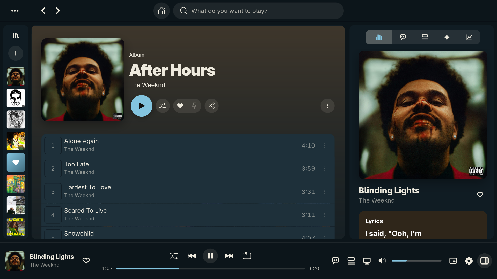
</p>

---

> [!NOTE]
> Canto is an unofficial client, not affiliated with or endorsed by Spotify. It needs a **Spotify Premium** account.

## What Canto does

**Lyrics**
- Synced lyrics from LRCLIB in the side panel or full screen over the blurred cover. The active line lights up word by word (with real word timing when LRCLIB has it, an estimate otherwise).
- When LRCLIB doesn't have a song, the lyrics come from **Genius** instead (not synced), and the line above the lyrics says where they came from. You can turn this off in **Preferences -> Integrations**.
- Click a line to jump there, nudge the timing live, and translate lyrics into your language, shown under each line.
- **Genius** annotations: tap the mark next to a line to read what it means, right inside the lyrics.

<p align="center">
  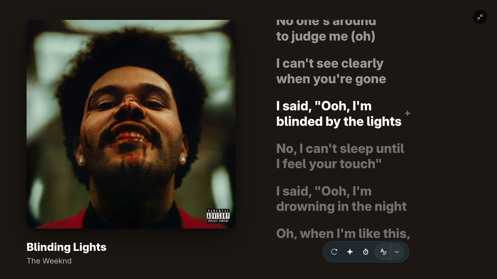
  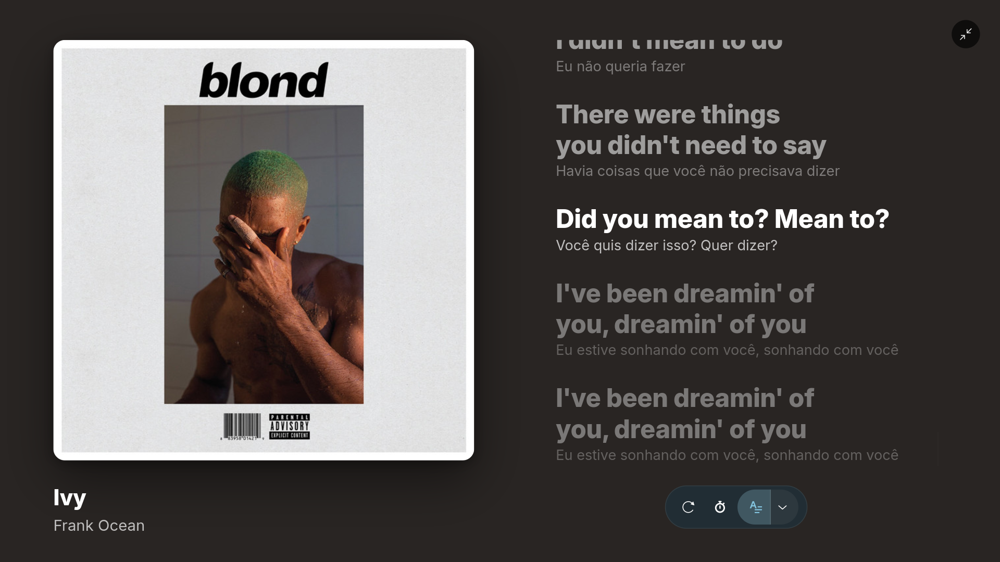
  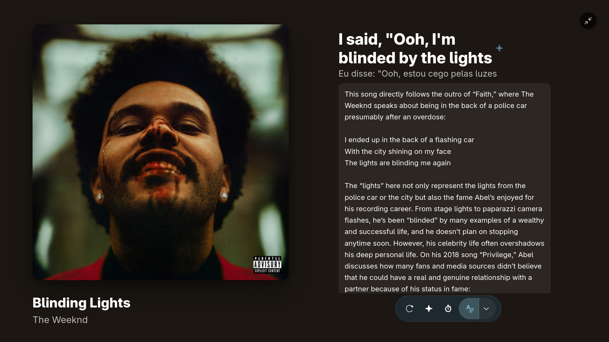
  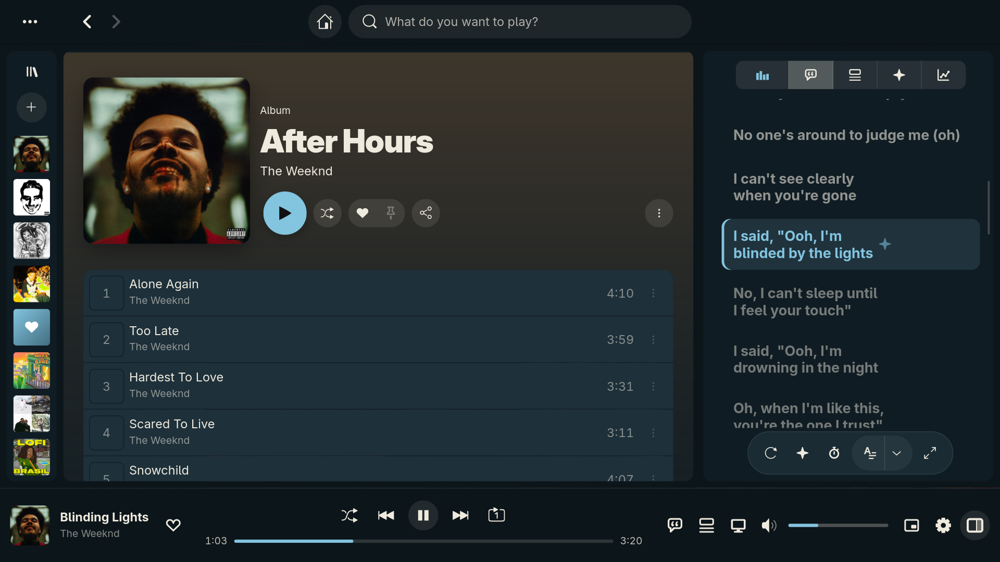
</p>

**Looks that follow your desktop**
- **Follow System** reads your Omarchy theme and changes with it, live. Built-in themes too: Neutral (Adwaita), Green, OLED Dark, Warm Vinyl and Purple Night.
- Optional background tint taken from the album cover.
- A player bar you can customize: right-click it to pick which buttons show and in what order.

**Listening**
- Now Playing panel with a big cover, a lyrics preview, the next track, how many times you played the song, album and artist (Last.fm), song credits and the song's story from **Genius**. The title takes you to the album, the artists to their pages.
- Your Library as a list or a grid of covers, with pinned items, Recents and sorting, plus a collapsed sidebar that keeps only the covers.
- Reopens on the track you closed it on, right where it stopped. Nothing plays until you press play.
- Plays here or on any Spotify Connect device, such as a phone or a smart speaker. On launch it follows the device that is already playing.
- Mini player window, track radio, a sleep timer, and **Your Stats** from Last.fm.
- Scrobbling to Last.fm and ListenBrainz, counting only real listening time, with an offline queue.

<p align="center">
  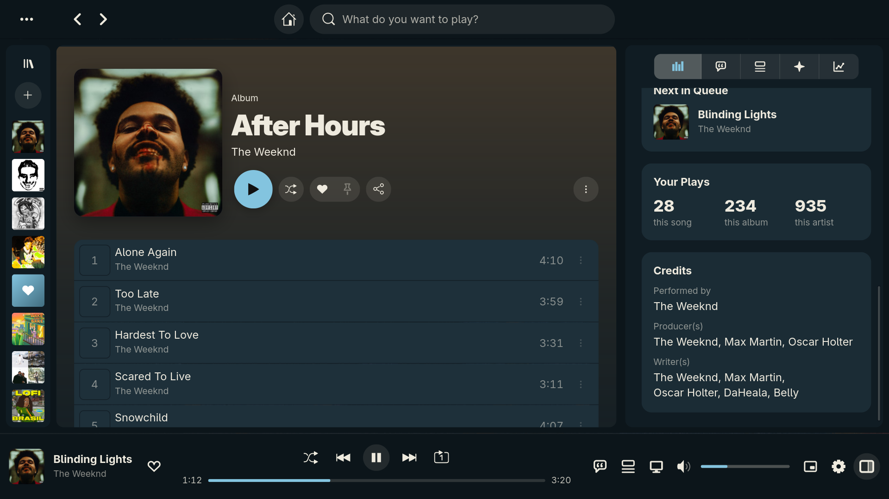
  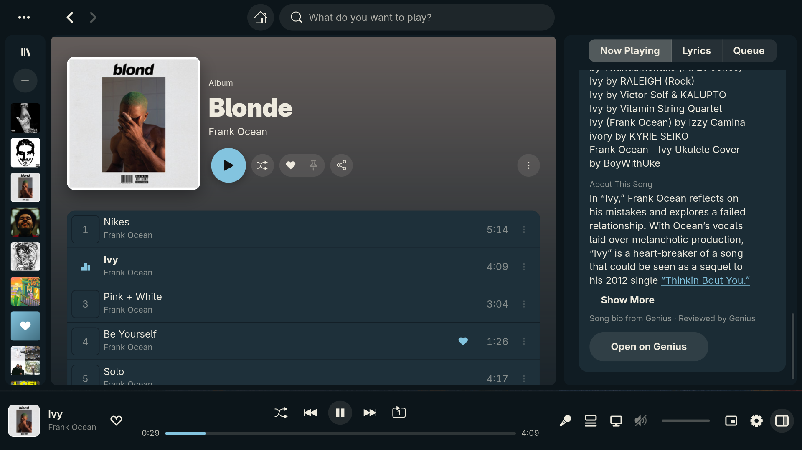
  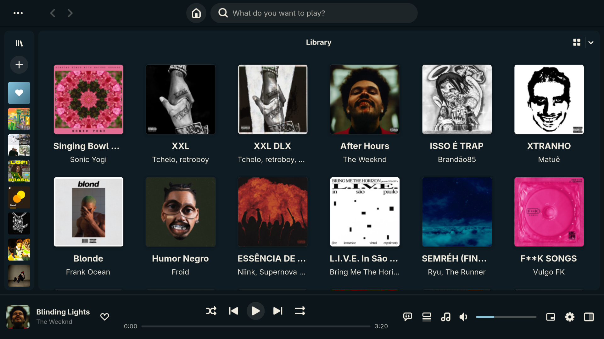
  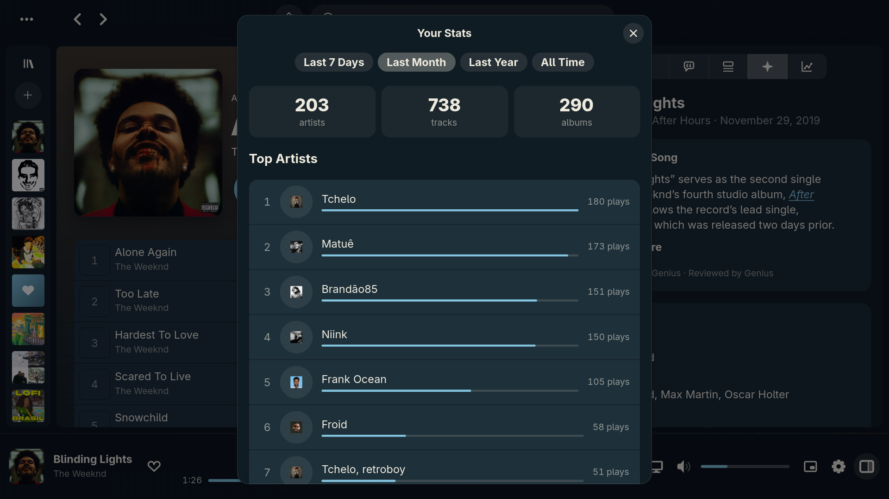
</p>
<p align="center">
  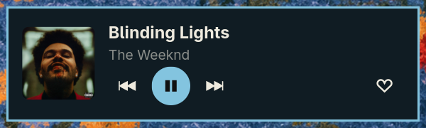
</p>

**Keyboard first**
- `Ctrl+K` command palette: navigation, themes, devices, sleep timer, track radio and search.
- Media keys (MPRIS), shortcuts for everything below, and touch gestures.

<p align="center">
  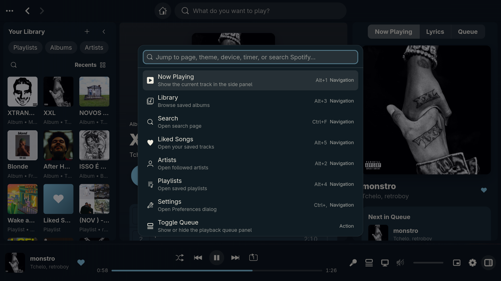
  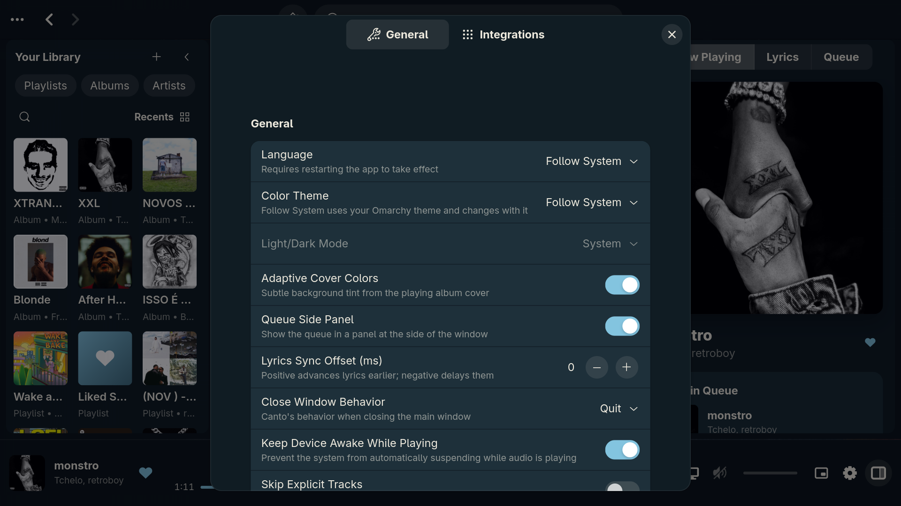
</p>

**Sound** (when Canto plays audio itself)
- Gapless playback, a 10-band equalizer with presets, stereo balance, mono and pitch shift.

**For tinkerers**
- Optional visual bridge: a lock-free level meter and an atomic `$XDG_RUNTIME_DIR/canto/state.json` for external visualizers (zero cost when off).
- Music providers sit behind a `MusicProvider` abstraction (see [docs/providers-architecture.md](docs/providers-architecture.md)).

## Keyboard Shortcuts

| Shortcut | Action |
| --- | --- |
| `Ctrl+K` | Command palette |
| `Ctrl+F` | Search |
| `Space` | Play / Pause |
| `Ctrl+[` / `Ctrl+]` | Previous / Next track |
| `Ctrl+Left` / `Ctrl+Right` | Seek backward / forward |
| `Ctrl+Up` / `Ctrl+Down` | Volume up / down |
| `Ctrl+M` | Mute |
| `Ctrl+S` / `Ctrl+R` | Shuffle / Repeat |
| `Alt+Left` / `Alt+Right` | Back / Forward |
| `Alt+1` .. `Alt+5` | Now Playing, Artists, Albums, Playlists, Tracks |
| `F9` | Toggle sidebar |
| `F10` | Main menu |
| `Ctrl+,` | Preferences |
| `Ctrl+?` | Keyboard shortcuts |
| `Ctrl+Q` | Quit |
| `Ctrl+Shift+D` | Developer tools (debug builds) |

## Hyprland Tip: Silent Spotify Connect Background Mode

If you want Canto running silently at login as a ready Spotify Connect receiver on Hyprland without interrupting your current workspace, assign it to a special workspace silently:

```conf
# ~/.config/hypr/hyprland.conf
windowrule = workspace special:canto silent, match:class ^(io\.github\.gusthanks\.Canto(\.Devel)?)$
exec-once = [workspace special:canto silent] canto
```

Toggle the scratchpad whenever you want to bring Canto forward (for example `bind = SUPER, M, togglespecialworkspace, canto`).

## Hyprland Tip: Floating Mini Player

The mini player (player bar button or `Ctrl+K` -> **Mini Player**) is a window titled `Canto Mini Player`. Tiling window managers tile it like any other window; to keep it floating on top in a corner:

```lua
-- Omarchy, ~/.config/hypr/hyprland.lua
o.window({ title = "^Canto Mini Player$" }, {
  float = true,
  pin = true,
  size = { 360, 130 },
  move = { "(monitor_w-window_w-40)", "(monitor_h-window_h-40)" },
})
```

## BYOK API Setup Tutorials

Canto works out of the box for browsing your library, LRCLIB synced lyrics, lyrics from Genius when LRCLIB has none, and Genius search links. Everything below is Bring-Your-Own-Key (BYOK): keys stay on your computer (GSettings / keyring) and are only sent to their own official APIs.

### 0. Spotify Soloist (playback)

Some accounts can't play audio inside Canto itself (Spotify's DRM blocks it). For those, Canto plays through **Spotify Soloist**, Spotify's official windowless player for Linux (x86_64), which Canto downloads and keeps up to date on its own. Soloist needs a free developer key:

1. Follow Spotify's guide at [developer.spotify.com/documentation/soloist](https://developer.spotify.com/documentation/soloist) to create the key (Premium account).
2. Paste it into **Preferences -> Spotify Soloist -> Soloist API Key** and turn on **Play Through Soloist**.

Without a key, Canto falls back to the official Spotify app running hidden in the background (it must be installed).


### 1. Spotify OAuth & Connect

Canto uses Spotify's OAuth 2.0 PKCE flow (`crates/canto-auth/src/oauth2.rs`) and listens on the exact local redirect URI:

```text
http://127.0.0.1:8898/login
```

Default builds ship with an OAuth Client ID (`782ae96ea60f4cdf986a766049607005`) pre-configured. If you are building Canto with your own Spotify Developer application:

1. Open the [Spotify Developer Dashboard](https://developer.spotify.com/dashboard) and click **Create app**.
2. Under **Redirect URIs**, add `http://127.0.0.1:8898/login` and select **Web API**.
3. Copy your **Client ID** into `CLIENT_ID` in `crates/canto-auth/src/oauth2.rs` and rebuild.
4. Launch Canto and click **Log in with Spotify**. Approve in your browser and it will redirect back to `127.0.0.1:8898/login` automatically.

Note: Spotify restricted `/v1/recommendations` and `/v1/artists/{id}/related-artists` for many newer Client IDs starting in November 2024. Canto detects 403/404 responses automatically and builds Track Radio from artist top tracks and catalog searches with deduplication.

### 2. Genius (Credits, Samples & Liner Notes)

To display producers, writers and featured artists in the **Now Playing** side panel:

1. Open [genius.com/api-clients/new](https://genius.com/api-clients/new) and sign in if asked. In Canto, **Preferences -> Integrations -> Genius -> How to get token** opens the same page and has copy buttons for every value below.
2. Fill in the **New API Client** form and click **Save**:

   | Field | Value |
   | --- | --- |
   | App Name | `Canto` |
   | Icon URL | keep the default |
   | App Website URL | `http://localhost` |
   | Redirect URI | `http://localhost` |

3. On the next page, click **Generate Access Token** and copy the **Client Access Token**. Canto doesn't need the Client ID or Client Secret.
4. Paste it into **Preferences -> Integrations -> Genius -> Client Access Token**.

Results are cached locally on disk so revisiting a track requires zero repeated API calls.

### 3. Last.fm (Scrobbling)

1. Open [last.fm/api/account/create](https://www.last.fm/api/account/create) and create an API application (a callback URL is optional for desktop auth).
2. Copy your **API Key** and **Shared Secret** into **Preferences -> Integrations -> Scrobbling**.
3. Click **1. Open Auth** to open Last.fm in your browser and approve Canto, then click **2. Complete** back in Canto to save your persistent session key.
4. Turn on **Enable Scrobbling** (and optionally **Scrobble Connect Devices** if you also want remote Connect speakers/phones tracked).

Canto tracks active listening duration only (ignoring pauses and duplicate Connect poll ticks) and scrobbles after `min(duration / 2, 240s)` for tracks at least 30 seconds long. Offline plays are queued locally (up to 500 entries) and retried automatically.

### 4. ListenBrainz (Scrobbling)

1. Open [listenbrainz.org/settings](https://listenbrainz.org/settings/) while signed in.
2. Copy your **User Token** and paste it into **Preferences -> Integrations -> ListenBrainz User Token**.
3. Turn on **Enable Scrobbling**.

You can enable Last.fm, ListenBrainz, or both simultaneously.

## Installing

There are no packages yet. Build from source:

```sh
./scripts/setup-dev.sh    # install system build dependencies
./scripts/build.sh dev    # compile a debug build with Meson + Cargo
./scripts/build.sh test   # unit tests and Clippy (not the GTK tests)
```

The GTK tests need a headless Broadway display, so `./scripts/build.sh test` skips them. Run them with `scripts/dev/gtk-tests.sh`, or run the whole check loop with `scripts/dev/round.sh`.

To install into `~/.local` (close Canto first):

```sh
./scripts/build.sh release --install
```

See the [Development Guide](doc/Development.md) for architecture notes, feature flags, and developer tools (`Ctrl+Shift+D`).

## Contributing

Contributors and AI agents: start at [AGENTS.md](AGENTS.md), then read [CONTRIBUTING.md](CONTRIBUTING.md).

## Acknowledgements

- [Riff](https://github.com/Diegovsky/riff) by Diego Augusto and contributors, and [Spot](https://github.com/xou816/spot) by Alexandre Trendel, which Canto is forked from (MIT).
- [ytm-rs](https://github.com/grapedjuice/ytm-rs) by grapedjuice and contributors, studied as a reference. Canto does not include ytm-rs code.

## Code of Conduct

This project follows the [GNOME Code of Conduct](https://conduct.gnome.org).
